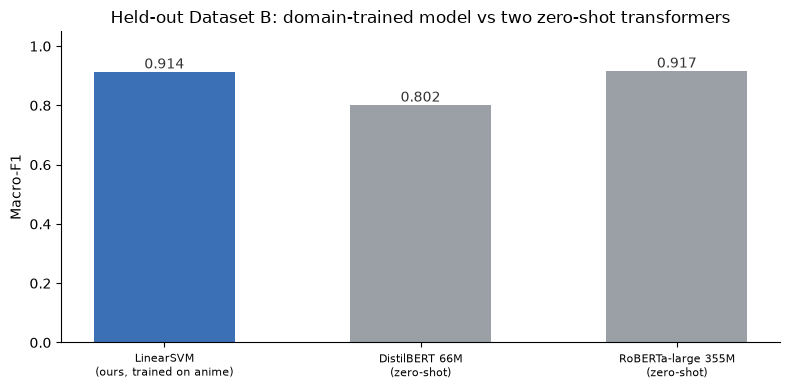
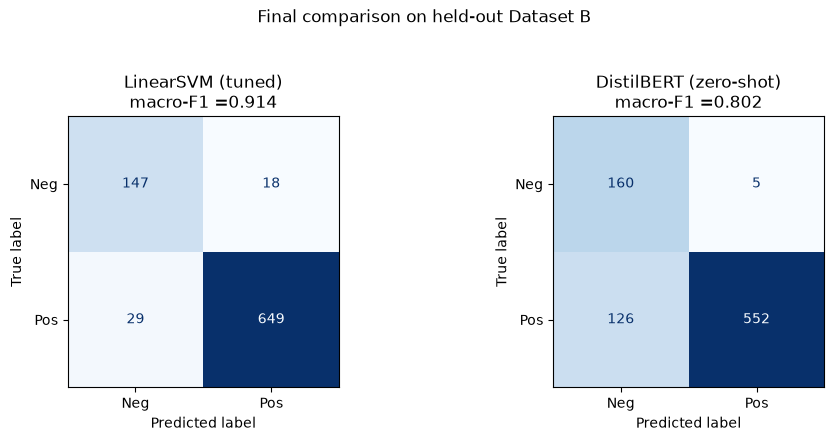
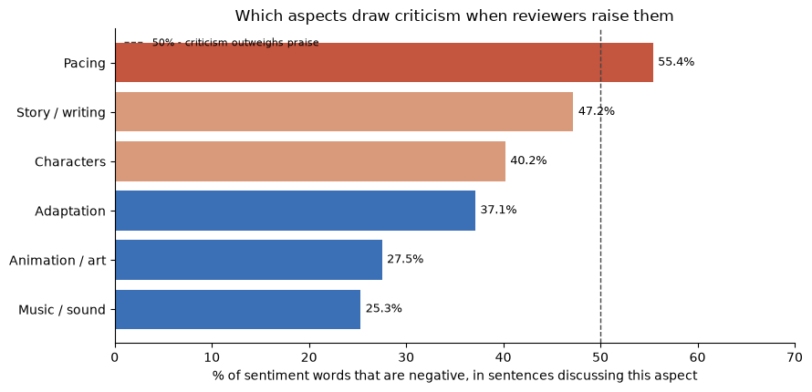
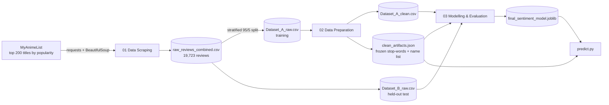

# Anime Review Sentiment Classifier


An end-to-end NLP pipeline that scrapes **~19,700 anime reviews** from MyAnimeList, cleans the text, and trains a model that labels each review as **positive** or **negative**. The model reaches **94.4% accuracy and 0.914 macro-F1** on reviews it never saw during training. It runs on an ordinary CPU, and the saved model is under 1 MB.



---

## What is this project?

Streaming platforms and anime studios get thousands of written reviews for every title. Reading them all by hand isn't realistic, but the reviews hold the answer to two questions the business cares about:

1. **Are viewers happy with this title?** (Is the reaction positive or negative overall?)
2. **If they aren't, why not?** (Is it the story, the animation, the pacing, the music…?)

This project builds a system that answers both, automatically:

- A **scraper** collects real reviews, together with the star rating each reviewer gave, from the 200 most popular anime on [MyAnimeList](https://myanimelist.net).
- The star rating becomes the label: **7–10 stars = positive**, **1–4 stars = negative**. Reviews rated 5–6 are left out because they're usually mixed. Every review arrives already labelled, so nobody had to tag data by hand.
- A **text-cleaning pipeline** strips noise from the reviews. It also removes **character and show names**, so the model learns *sentiment words* ("boring", "masterpiece") rather than memorising that certain shows are popular. This means it also works on **new shows it has never seen**.
- A **classifier** reads a review and predicts whether it's positive or negative.
- A **business layer** turns the predictions into a per-title "platform health" score with an alert for underperforming titles. An **aspect analysis** then shows *what* reviewers complain about: pacing is the only aspect where criticism outweighs praise.

The project follows the CRISP-DM process, from data collection to evaluation. Every decision is explained and checked against data in the notebooks.

---

## Results

### Final test: Dataset B (843 reviews held out from the start)

| Model | Accuracy | Macro-F1 | F1 (negative) | Time per review |
|---|---|---|---|---|
| **Linear SVM + TF-IDF (this project)** | **0.9442** | 0.9136 | 0.8622 | **~23 ms** |
| DistilBERT, pre-trained (zero-shot) | 0.8446 | 0.8017 | 0.7095 | ~90 ms |
| RoBERTa-large, pre-trained (zero-shot) | 0.9431 | **0.9166** | **0.8696** | ~600 ms |

The small linear model **matches a 355M-parameter transformer on accuracy and comes within 0.003 macro-F1**, while being about **25× faster** per review on a CPU. Its decisions can also be explained, because you can read its word weights directly.

> **Why macro-F1?** The data is ~80% positive, so a model that always says "positive" already scores ~80% accuracy. Macro-F1 averages the score of both classes equally, so it shows whether the model actually recognises negative reviews.

### Model selection (5-fold cross-validation on the training set)

| Model | Bag-of-Words | TF-IDF |
|---|---|---|
| Linear SVM | 0.8755 | **0.8989** |
| Logistic Regression | 0.8871 | 0.8962 |
| Multinomial Naive Bayes | 0.8720 | 0.6150 |

Naive Bayes collapses on TF-IDF, because it assumes raw word counts, while the linear models prefer TF-IDF. A grid search over the vectoriser and the SVM's `C` didn't improve on the defaults. Most of the performance comes from the data preparation, not from tuning.

<p align="center">
  
  
</p>

### Key findings

- **The model learned sentiment, not show names.** Its strongest weights are words like *great, fun, amazing* vs *bad, boring, waste, pathetic*, and no character or show name appears among them. It also picked up subtler signals: the bigram *"not recommend"*, and *"decent"* as faint praise that leans negative.
- **Errors cluster where the label itself is weakest.** The highest error rates are at 4 stars (22.5%) and 7 stars (15.2%), the ratings just either side of the dropped neutral band. At 10 stars the error rate is only 1.7%.
- **The confident mistakes are about context, not vocabulary.** Examples include praise aimed at a *different* show, irony, and reviewers arguing against someone else's opinion. A bag-of-words model can't see these, which points at where a transformer would help.
- **Pacing is the aspect viewers complain about most** (55.4% negative when it's mentioned). Music and animation are praised the most (~25–28% negative).

---

## How it works



### 1. Data scraping ([`01_Data_Scraping.ipynb`](01_Data_Scraping.ipynb))

- Builds an index of the 200 most popular titles from MyAnimeList's popularity ranking. Popular titles have thousands of reviews each; the newest titles often have none.
- Scrapes up to 5 pages (100 reviews) per title. The cap keeps any one show from dominating the data.
- Parses each review with BeautifulSoup and removes embedded widgets such as "Reviewer's Rating: 10". If they stayed in, they would leak the label into the text.
- Scrapes politely: a 1 s delay plus random jitter, back-off on HTTP 403/429, a disk cache so no page is downloaded twice, and checkpoints so a crash loses nothing. Usernames and profile data are never stored.
- Checks the raw data (structure, missing values, rating range, duplicates) without changing it, then saves a **rating-stratified 95/5 split**. Dataset B is locked away until the final test.

### 2. Data preparation ([`02_Data_Preparation.ipynb`](02_Data_Preparation.ipynb))

- Explores the raw corpus first (rating spread, review length, per-show vocabulary). The findings drive the cleaning choices.
- Removes duplicates and derives the label (7–10 → 1, 1–4 → 0, 5–6 dropped). That leaves **16,021 reviews, 80.4% positive**.
- One reusable `clean_text()` function: lowercase → strip HTML and URLs → remove digits and punctuation → tokenise → **POS-aware lemmatisation** → remove stop-words.
  - **Negation words are kept** ("not", "never"), so "not good" doesn't become "good".
  - Domain filler words (*anime, episode, season…*) are added to the stop-word list.
  - Lemmatisation was chosen over stemming after a side-by-side test on the data. It keeps words readable (*beautiful*, not *beauti*) and handles irregular forms (*worse → bad*).
- **Removes show and character names using data, not a hand-made list.** A word is treated as a name if it's frequent (≥ 30 uses) but appears in **≤ 15% of the titles** (30 of 200). A second test catches words from the show titles themselves that aren't English (checked against WordNet). This produces 2,427 names to strip. The cut-off was checked against an external sentiment lexicon (Hu & Liu, 2004): real sentiment words appear in 34 to 200 shows, so they're safely kept.
- Engineers six style features from the *raw* text (question marks, ALL-CAPS words, etc.) and keeps only the two that actually differ between the classes. Negative reviews contain 2.5× more question marks.
- Saves the cleaned data, plus `clean_artifacts.json`: the exact stop-word and name lists, frozen so the test set and new reviews are cleaned identically.

### 3. Modelling and evaluation ([`03_Modelling.ipynb`](03_Modelling.ipynb))

- Compares 3 models × 2 text representations (Bag-of-Words, TF-IDF with unigrams and bigrams) using stratified 5-fold cross-validation. The linear models use `class_weight="balanced"` to handle the 4 : 1 imbalance.
- Tests whether the style features help: the difference is under 0.001, i.e. no measurable effect.
- Tunes the best combination with `GridSearchCV`, then looks closely at it: classification report, confusion matrix, ROC and precision-recall curves, top-weighted words, and the individual mistakes.
- Benchmarks against two pre-trained transformers (DistilBERT, RoBERTa-large), run zero-shot on the raw text.
- Retrains on all of Dataset A, cleans Dataset B with the frozen artifacts, and scores it **once**.
- **Business scenario:** a per-title "platform health" dashboard (% positive, with an alert above 30% negative). Its predictions are checked against the withheld star ratings. A rule to send low-confidence negative predictions to a human catches both of the dashboard's errors.
- **Aspect analysis:** splits reviews into sentences and counts sentiment words near mentions of story, animation, characters, pacing, music and adaptation. This is done per title and compared against the catalogue average.

---

## Getting started

### Requirements

- **Python 3.11 or newer** (developed on Python 3.14)
- About **3 GB of free disk space** if you run everything: ~2 GB for PyTorch/Transformers, ~1.7 GB for the transformer models, ~500 MB for the scraped data
- An internet connection for the first run (scraping, plus NLTK and Hugging Face downloads)

### Setup in a new workspace

**1. Clone the repository**

```bash
git clone https://github.com/Snorlax03/Anime-Reviews.git
cd Anime-Reviews
```

**2. Create and activate a virtual environment**

```bash
python -m venv .venv
```

| Your system | Activate command |
|---|---|
| Windows (PowerShell) | `.venv\Scripts\Activate.ps1` |
| Windows (Command Prompt) | `.venv\Scripts\activate.bat` |
| macOS / Linux | `source .venv/bin/activate` |

> On Windows, if PowerShell blocks the script, run `Set-ExecutionPolicy -Scope CurrentUser RemoteSigned` once and try again.

<details>
<summary>Prefer conda?</summary>

```bash
conda create -n anime-sentiment python=3.12
conda activate anime-sentiment
```
</details>

**3. Install the dependencies**

```bash
pip install -r requirements.txt
```

NLTK's language data (tokeniser, WordNet, POS tagger, opinion lexicon) downloads automatically the first time a notebook or `predict.py` runs.

**4. Open the notebooks**

- **Jupyter:** run `jupyter notebook` and open `01_Data_Scraping.ipynb`.
- **VS Code:** open the project folder, open a notebook, click **Select Kernel** in the top-right corner, and choose the `.venv` interpreter.

Run the notebooks **in order (01 → 02 → 03)**, from the project's root folder, since all paths are relative to `data/`.

### Option A: just use the trained model (no scraping, about a minute)

The trained model and its cleaning artifacts are included in the repo, so you can classify reviews straight away:

```bash
python predict.py "The animation was stunning and the ending made me cry. Masterpiece!" "Boring, rushed and a total waste of time. Why did I watch this?"
```

```text
positive +0.88  The animation was stunning and the ending made me cry. Masterpiece!
negative -2.24  Boring, rushed and a total waste of time. Why did I watch this?
```

To classify a whole file, put one review per line and run `python predict.py --file my_reviews.txt`.

Or from Python:

```python
from predict import predict

predict(["Great show!", "Boring and rushed."])
# [{'label': 'positive', 'score': ..., 'low_confidence': ..., 'text': 'Great show!'}, ...]
```

The `score` is the SVM's distance from its decision boundary: positive above 0, negative below, and more confident the further it is from 0. Predictions with `|score| < 0.5` are marked `low_confidence`.

`predict.py` applies exactly the same cleaning as the training pipeline. It reproduces the notebook's Dataset B result (accuracy 0.9442, macro-F1 0.9136).

### Option B: run the full pipeline

| Notebook | First run | Re-run (caches present) |
|---|---|---|
| 01 Data Scraping | ~33 min | under 1 min |
| 02 Data Preparation | ~6 min | ~6 min |
| 03 Modelling | ~20 min | ~7 min |

Times are on a CPU-only laptop. No GPU is needed.

> **Your numbers will differ slightly from the saved outputs.** The notebooks scrape the *live* site, and MyAnimeList changes over time: new reviews, a shifting popularity ranking, edited or deleted reviews. The outputs saved in the notebooks come from the original run in July 2026.

**Quicker run:** in notebook 1's configuration cell, set `MAX_REVIEW_PAGES = 1` and/or `N_TITLES = 100`. With both, the whole pipeline takes about 8 minutes. Notebooks 2 and 3 need no changes, and the name-removal threshold scales automatically with the number of titles.

---

## Settings you can change

Each setting lives near the top of the relevant notebook section.

### Notebook 1: Data scraping (configuration cell)

| Setting | Default | What it controls |
|---|---|---|
| `N_TITLES` | `200` | How many of the most popular titles to scrape |
| `MAX_REVIEW_PAGES` | `5` | Review pages per title (20 reviews each, so up to 100 per title) |
| `REQUEST_DELAY` | `1` | Seconds between requests, plus 0–0.5 s of random jitter. Please don't lower it |
| `RANDOM_STATE` | `42` | Seed for the 95/5 train/test split |
| `HEADERS` | browser-like | HTTP headers. MyAnimeList's firewall rejects requests without them |

### Notebook 2: Data preparation

| Setting | Default | Where | What it controls |
|---|---|---|---|
| `derive_sentiment()` | 7–10 → 1, 1–4 → 0 | Step 1b | Rating thresholds for the label. 5–6 are dropped |
| `NEGATIONS` | 19 words | Step 3 | Words taken *out* of the stop-word list so negation survives |
| `DOMAIN_STOP` | 20 words | Step 3 | Anime-specific filler words removed as stop-words |
| `FREQ_MIN` | `30` | Step 6a | Minimum uses before a word can be treated as a name |
| `SHOWS_MAX` | 15% of titles | Step 6a | A frequent word appearing in this many titles or fewer is treated as a name |
| Screening thresholds | `1.15` / `0.87` | Step 7c | A style feature is kept only if its negative/positive ratio differs by more than ~15% |
| `MIN_SHOWS_FOR_RANK` | `40` | Step 8a | Minimum number of shows for a word to appear in the "most distinctive words" ranking |

### Notebook 3: Modelling and evaluation

| Setting | Default | Where | What it controls |
|---|---|---|---|
| `build_features()` | `ngram_range=(1, 2)`, `min_df=5`, `max_features=20000` | Step 2 | Vectoriser vocabulary settings |
| `test_size` | `0.20` | Step 1 | Size of the validation split |
| `models` | NB, LogReg, Linear SVM | Step 3 | The candidate classifiers |
| `param_grid` | `ngram_range`, `min_df`, `C` (or `alpha` for NB) | Step 5 | Grid search space |
| `DISTILBERT`, `ROBERTA` | Hugging Face model names | Transformer cache cell | Benchmark models. Any binary sentiment model from the Hugging Face Hub works |
| `batch_size` | `16` / `8` | Steps 7, 8e | Transformer batch sizes. Lower them if you run out of memory |
| `DEMO_TITLES` | 3 titles | Step 10 | Titles shown in the dashboard. They must exist in Dataset B |
| `ALERT_THRESHOLD` | `0.30` | Step 10 | Negative share that triggers an "underperforming" alert |
| `ASPECT_TERMS` | 6 aspects | Step 11 | Keywords that define each aspect (story, animation, pacing, …) |
| `MIN_SENTENCES` | `10` | Step 11d | Aspects with fewer supporting sentences are hidden as too noisy |

### Caches

| Folder | What it holds | Delete it to… |
|---|---|---|
| `data/cache/` | Every scraped HTML page | Force a completely fresh scrape |
| `data/transformer_cache/` | DistilBERT and RoBERTa predictions | Re-run transformer inference (results are deterministic) |

---

## Data

The datasets aren't included in this repository. The review text belongs to MyAnimeList's users, and the files are large. Running notebook 1 creates them:

| File | Created by | Contents |
|---|---|---|
| `data/raw_reviews_combined.csv` | Notebook 1 | Every scraped review, unmodified |
| `data/Dataset_A_raw.csv` | Notebook 1 | ~95% of reviews, used for training and validation |
| `data/Dataset_B_raw.csv` | Notebook 1 | ~5% of reviews, held out for the final test |
| `data/Dataset_A_clean.csv` | Notebook 2 | Labelled and cleaned training data |
| `data/clean_artifacts.json` | Notebook 2 | Frozen stop-words, name strip-set and kept features *(included in the repo)* |
| `data/final_sentiment_model.joblib` | Notebook 3 | The trained pipeline *(included in the repo)* |

**Raw columns:** `anime_id`, `anime_title`, `rating` (1–10), `tag` (the reviewer's Recommended / Mixed Feelings / Not Recommended verdict), `review_date`, `review_text`.

**Cleaned columns add:** `sentiment` (1 = positive, 0 = negative), `raw_word_count`, `clean_word_count`, `unique_word_count`, `question_count`, `uppercase_word_count`, `clean_text`.

---

## Project structure

```text
Anime-Reviews/
├── 01_Data_Scraping.ipynb        # scrape MyAnimeList, verify, split A/B
├── 02_Data_Preparation.ipynb     # EDA, labelling, cleaning, name removal, features
├── 03_Modelling.ipynb            # model comparison, tuning, benchmarks, evaluation, business analysis
├── predict.py                    # classify new reviews with the trained model
├── requirements.txt
├── LICENSE
├── data/
│   ├── final_sentiment_model.joblib   # included
│   ├── clean_artifacts.json           # included
│   └── ...                            # CSVs and caches, created when you run the notebooks
└── docs/images/                  # charts used in this README
```

---

## Data ethics and scraping

This was a **non-commercial, educational project**, and the scraper was designed to be as light on the site as possible:

- Requests are spaced at least 1 second apart (close to a person browsing), back off when the server pushes back, and are cached so no page is fetched twice.
- Only public pages are used, with no login. **No usernames, avatars or profile links are stored.**
- **The scraped reviews are not redistributed.** The datasets are excluded from this repository; the notebooks quote only short excerpts to illustrate the analysis.
- `robots.txt` doesn't disallow review pages. However, MyAnimeList's [Terms of Use](https://myanimelist.net/membership/terms_of_use) do not permit scraping without the site's prior written consent, and they limit use of the site to personal, non-commercial purposes.

**If you run the scraper,** you are responsible for complying with MyAnimeList's Terms of Use. Keep the request delay as it is, and don't republish the collected reviews. To use the trained model without scraping anything, see [Option A](#option-a-just-use-the-trained-model-no-scraping-about-a-minute).

---

## Limitations and next steps

- **Very famous names can slip through the name filter.** Words like *jujutsu* or *academia* are real English words, so the WordNet test keeps them.
- **Bag-of-words can't read context.** It misses irony, praise aimed at a different show, and slang such as "so bad" meaning good. These account for most of the confident errors.
- **Mixed reviews (5–6 stars) were excluded**, so the model has never learned to handle them.
- **The transformers were only run zero-shot**, because fine-tuning on a CPU would take hours. Fine-tuning RoBERTa on this corpus is the natural next experiment, and would likely beat both models.
- **The negative class is the weak spot** (F1 0.86 vs 0.96). Scraping more low-rated titles is the highest-value improvement.
- The aspect analysis is lexicon-based: it links sentiment to an aspect by sentence, not by grammar. It's good enough to rank aspects, but not to quote exact percentages.

---

## Tech stack

Python · pandas · NumPy · requests · BeautifulSoup · NLTK · scikit-learn · Hugging Face Transformers · PyTorch · Matplotlib · WordCloud · Jupyter

## License

The code is released under the [MIT](LICENSE) licence: free to use, modify and share with attribution. The licence covers this repository's code only, not MyAnimeList's content or its users' reviews.

## Disclaimer

This project is not affiliated with, endorsed by or sponsored by MyAnimeList. "MyAnimeList" is used only to identify the source of the data. Review text belongs to its respective authors, and anime titles belong to their respective rights holders.
