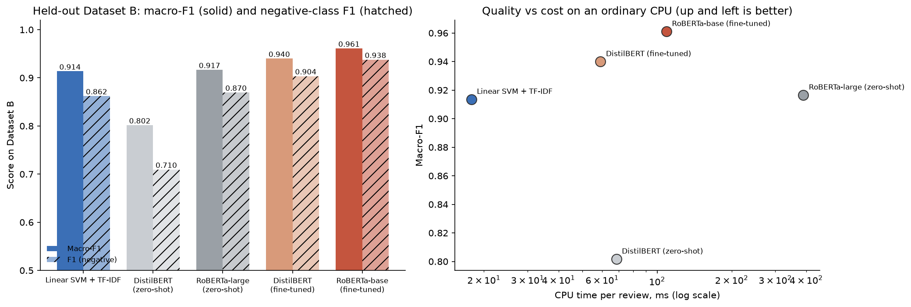
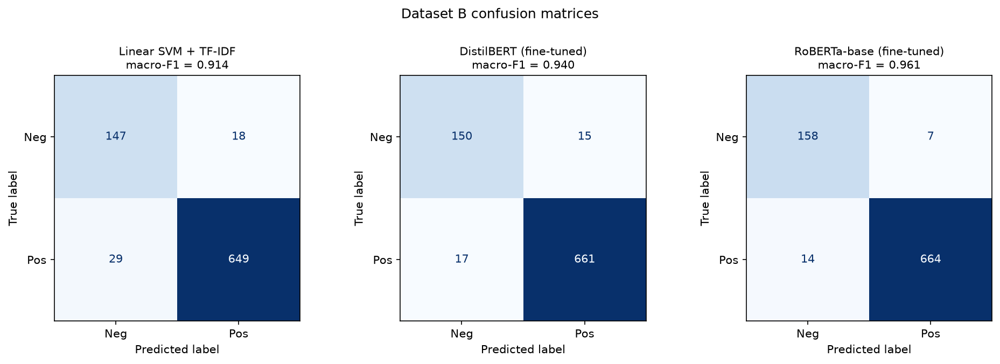
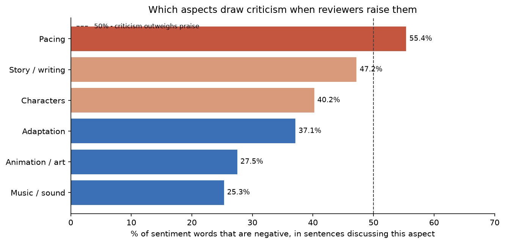
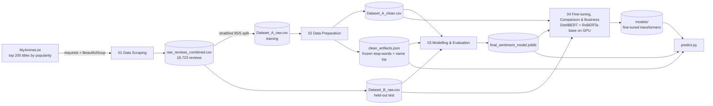

# Anime Review Sentiment Classifier


An end-to-end NLP pipeline that scrapes **~19,700 anime reviews** from MyAnimeList, cleans the text, and trains a model that labels each review as **positive** or **negative**. A fast, explainable **Linear SVM** reaches **94.4% accuracy and 0.914 macro-F1** on reviews it never saw during training, running on an ordinary CPU with a model under 1 MB. **Fine-tuning RoBERTa-base on the same reviews on a GPU** raises that to **97.5% accuracy and 0.961 macro-F1**, more than halving the mistakes (47 → 21 of 843), at the cost of ~6× slower CPU inference and a 502 MB model.



---

## What is this project?

Streaming platforms and anime studios get thousands of written reviews for every title. Reading them all by hand isn't realistic, but the reviews hold the answer to two questions the business cares about:

1. **Are viewers happy with this title?** (Is the reaction positive or negative overall?)
2. **If they aren't, why not?** (Is it the story, the animation, the pacing, the music…?)

This project builds a system that answers both, automatically:

- A **scraper** collects real reviews, together with the star rating each reviewer gave, from the 200 most popular anime on [MyAnimeList](https://myanimelist.net).
- The star rating becomes the label: **7–10 stars = positive**, **1–4 stars = negative**. Reviews rated 5–6 are left out because they're usually mixed. Every review arrives already labelled, so nobody had to tag data by hand.
- A **text-cleaning pipeline** strips noise from the reviews. It also removes **character and show names**, so the model learns *sentiment words* ("boring", "masterpiece") rather than memorising that certain shows are popular. This means it also works on **new shows it has never seen**.
- A **classifier** reads a review and predicts whether it's positive or negative. A fast, explainable Linear SVM is compared with transformers fine-tuned on the same data, and the model to deploy is chosen on validation results and cost. Fine-tuned RoBERTa-base wins, mostly by catching more negative reviews.
- A **business layer** turns the predictions into a per-title "platform health" score with an alert for underperforming titles. An **aspect analysis** then shows *what* reviewers complain about: pacing is the only aspect where criticism outweighs praise.

The work is split into four notebooks, each answering one question and handing its findings to the next:

| Notebook | Question | What it found |
|---|---|---|
| [1. Data Scraping](01_Data_Scraping.ipynb) | Can we collect labelled reviews without labelling anything by hand? | 19,723 reviews from 200 titles, each labelled by the reviewer's own star rating |
| [2. Data Preparation](02_Data_Preparation.ipynb) | How do we clean the text so a model learns sentiment, not show names? | 16,021 labelled reviews; 2,427 show and character names stripped by a statistical rule |
| [3. Modelling & Evaluation](03_Modelling.ipynb) | How good is a simple, fast model, and how does it compare with pre-trained transformers used as they are (zero-shot)? | A Linear SVM reaches 0.914 macro-F1, beating zero-shot DistilBERT and almost matching zero-shot RoBERTa-large at over 20× the speed. Its remaining mistakes are about context, which word counts can't see |
| [4. Fine-tuning, Comparison & Business](04_Transformer_Finetuning.ipynb) | Does a transformer trained on *these* reviews beat the SVM, is it worth the cost, and what does the business do with the predictions? | Yes. Fine-tuned RoBERTa-base reaches 0.961 macro-F1 and fixes 37 of the SVM's 47 mistakes, beating zero-shot RoBERTa-large with a third of the parameters. It's recommended for the dashboard, with the SVM kept for explanations and as a second opinion |

The project follows the CRISP-DM process, from data collection to evaluation. Every decision is explained and checked against data in the notebooks.

---

## Results

### Final test: Dataset B (843 reviews held out from the start)

<!-- RESULTS_TABLE:START -->
| Model | Accuracy | Macro-F1 | F1 (negative) | CPU, 1 review | GPU, 1 review |
|---|---|---|---|---|---|
| Linear SVM + TF-IDF (notebook 3) | 0.9442 | 0.9136 | 0.8622 | **~18 ms** | — |
| DistilBERT, pre-trained (zero-shot) | 0.8446 | 0.8017 | 0.7095 | ~68 ms | ~12 ms |
| RoBERTa-large, pre-trained (zero-shot) | 0.9431 | 0.9166 | 0.8696 | ~389 ms | ~27 ms |
| DistilBERT, fine-tuned (notebook 4) | 0.9620 | 0.9400 | 0.9036 | ~59 ms | **~10 ms** |
| **RoBERTa-base, fine-tuned (notebook 4)** (deployed) | **0.9751** | **0.9611** | **0.9377** | ~109 ms | ~12 ms |

*843 held-out reviews. Latency = one review at a time, end to end; GPU = NVIDIA GeForce RTX 4060 Laptop GPU, fp16. Generated by `04_Transformer_Finetuning.ipynb`.*
<!-- RESULTS_TABLE:END -->

**Fine-tuning made the difference, not model size.** Before fine-tuning, the small linear model matched a 355M-parameter transformer used zero-shot (0.914 vs 0.917 macro-F1) at over 20× the speed. Once trained on these anime reviews, a 125M-parameter RoBERTa-base beats both clearly: **0.961 macro-F1, with negative-class F1 up from 0.862 to 0.938**. Zero-shot DistilBERT was the weakest model (0.802); fine-tuned, it reaches 0.940.

**Is it worth the cost?** For a review dashboard, yes. RoBERTa-base takes ~12 ms per review on a GPU and ~109 ms on a CPU, which is plenty for daily review volumes. The SVM stays useful: it is ~6× faster on a CPU, under 1 MB, and its word weights explain each decision. The deployed model was chosen on **validation** results before Dataset B was scored (0.966 vs 0.900 macro-F1 for the SVM).

> **Why macro-F1?** The data is ~80% positive, so a model that always says "positive" already scores ~80% accuracy. Macro-F1 averages the score of both classes equally, so it shows whether the model actually recognises negative reviews.

### Model selection (5-fold cross-validation on the training set)

| Model | Bag-of-Words | TF-IDF |
|---|---|---|
| Linear SVM | 0.8755 | **0.8989** |
| Logistic Regression | 0.8871 | 0.8962 |
| Multinomial Naive Bayes | 0.8720 | 0.6150 |

Naive Bayes collapses on TF-IDF, because it assumes raw word counts, while the linear models prefer TF-IDF. A grid search over the vectoriser and the SVM's `C` didn't improve on the defaults. Most of the performance comes from the data preparation, not from tuning.

<p align="center">
  
  
</p>

### Key findings

- **The model learned sentiment, not show names.** Its strongest weights are words like *great, fun, amazing* vs *bad, boring, waste, pathetic*, and no character or show name appears among them. It also picked up subtler signals: the bigram *"not recommend"*, and *"decent"* as faint praise that leans negative.
- **Errors cluster where the label itself is weakest.** The SVM's highest error rates are at 4 stars and 7 stars, the ratings just either side of the dropped neutral band. Fine-tuning cuts these sharply (on Dataset B, 4 stars: 21.4% → 7.1%; 7 stars: 16.2% → 8.1%), but they remain the hardest reviews for every model.
- **The confident mistakes are about context, not vocabulary.** Examples include praise aimed at a *different* show, irony, and reviewers arguing against someone else's opinion. A bag-of-words model can't see these. The fine-tuned RoBERTa-base gets 37 of the SVM's 47 Dataset B mistakes right, such as reviews written as lists of category scores, or jokes that open with "Was this even an anime?".
- **The fine-tuned transformer is over-confident.** It scores its own mistakes at P = 1.00, so a low-confidence threshold flags little. The two models disagree on only 6% of reviews, and those hold about half of the transformer's errors, so disagreement is the better signal for sending a review to a human.
- **Pacing is the aspect viewers complain about most** (55.4% negative when it's mentioned). Music and animation are praised the most (~25–28% negative).

---

## How it works



### 1. Data scraping ([`01_Data_Scraping.ipynb`](01_Data_Scraping.ipynb))

- Builds an index of the 200 most popular titles from MyAnimeList's popularity ranking. Popular titles have thousands of reviews each; the newest titles often have none.
- Scrapes up to 5 pages (100 reviews) per title. The cap keeps any one show from dominating the data.
- Parses each review with BeautifulSoup and removes embedded widgets such as "Reviewer's Rating: 10". If they stayed in, they would leak the label into the text.
- Scrapes politely: a 1 s delay plus random jitter, back-off on HTTP 403/429, a disk cache so no page is downloaded twice, and checkpoints so a crash loses nothing. Usernames and profile data are never stored.
- Checks the raw data (structure, missing values, rating range, duplicates) without changing it, then saves a **rating-stratified 95/5 split**. Dataset B is locked away until the final test.

### 2. Data preparation ([`02_Data_Preparation.ipynb`](02_Data_Preparation.ipynb))

- Explores the raw corpus first (rating spread, review length, per-show vocabulary). The findings drive the cleaning choices.
- Removes duplicates and derives the label (7–10 → 1, 1–4 → 0, 5–6 dropped). That leaves **16,021 reviews, 80.4% positive**.
- One reusable `clean_text()` function: lowercase → strip HTML and URLs → remove digits and punctuation → tokenise → **POS-aware lemmatisation** → remove stop-words.
  - **Negation words are kept** ("not", "never"), so "not good" doesn't become "good".
  - Domain filler words (*anime, episode, season…*) are added to the stop-word list.
  - Lemmatisation was chosen over stemming after a side-by-side test on the data. It keeps words readable (*beautiful*, not *beauti*) and handles irregular forms (*worse → bad*).
- **Removes show and character names using data, not a hand-made list.** A word is treated as a name if it's frequent (≥ 30 uses) but appears in **≤ 15% of the titles** (30 of 200). A second test catches words from the show titles themselves that aren't English (checked against WordNet). This produces 2,427 names to strip. The cut-off was checked against an external sentiment lexicon (Hu & Liu, 2004): real sentiment words appear in 34 to 200 shows, so they're safely kept.
- Engineers six style features from the *raw* text (question marks, ALL-CAPS words, etc.) and keeps only the two that actually differ between the classes. Negative reviews contain 2.5× more question marks.
- Saves the cleaned data, plus `clean_artifacts.json`: the exact stop-word and name lists, frozen so the test set and new reviews are cleaned identically.

### 3. Modelling and evaluation ([`03_Modelling.ipynb`](03_Modelling.ipynb))

**Step 1: our own model comparison.**
- Compares 3 models × 2 text representations (Bag-of-Words, TF-IDF with unigrams and bigrams) using stratified 5-fold cross-validation. The linear models use `class_weight="balanced"` to handle the 4 : 1 imbalance.
- Tests whether the style features help: the difference is under 0.001, i.e. no measurable effect.
- Tunes the best combination (Linear SVM + TF-IDF) with `GridSearchCV`, then looks closely at it: classification report, confusion matrix, ROC and precision-recall curves, top-weighted words, and the individual mistakes.

**Step 2: benchmark against zero-shot transformers.**
- Runs two pre-trained sentiment transformers *as they are*, with no training on this data: DistilBERT (trained on movie reviews) and RoBERTa-large (355M parameters). Both read the raw text.
- Is a small model trained on anime reviews good enough, or does a big general-purpose model do much better?

**Step 3: final test.**
- Retrains the SVM on all of Dataset A, cleans Dataset B with the frozen artifacts, scores it **once**, and saves the model.

**Why it leads to notebook 4.** Zero-shot DistilBERT did badly because it learned sentiment from movie reviews, not because transformers can't do this. Zero-shot RoBERTa-large matched the SVM without seeing a single anime review. Meanwhile the SVM's confident mistakes are context errors (irony, praise for a different show) that bag-of-words can't see. All three point to the same experiment: fine-tune a transformer on these reviews.

### 4. Fine-tuning, comparison and business ([`04_Transformer_Finetuning.ipynb`](04_Transformer_Finetuning.ipynb))

Picks up the question notebook 3 leaves open: does training a transformer on *these* reviews beat the SVM, and is it worth the extra cost? Base-sized models are used because they fit an 8 GB GPU and are realistic to deploy. If one beats the SVM, the anime-specific training is what made the difference, not sheer size.

- Fine-tunes **DistilBERT** and **RoBERTa-base** on a GPU (fp16 mixed precision), using **the same training / validation split as notebook 3**, so the comparison is like-for-like. A plain PyTorch loop with class-weighted cross-entropy (the same weights as `class_weight="balanced"`), AdamW with warm-up, gradient accumulation, and early stopping on validation macro-F1.
- Long reviews (47% are over 512 tokens) are cut **head + tail**: the first 128 and last 382 tokens, keeping the reviewer's closing verdict. The function lives in `predict.py`, so training and prediction cut text identically.
- Chooses the model to deploy **on validation results before touching Dataset B**: the cheapest model within 0.005 macro-F1 of the best.
- Scores all five models on Dataset B once (accuracy, macro-F1, negative-class F1) and times them one review at a time on the CPU and the GPU. It writes the results table in this README.
- Error analysis: which of the SVM's context mistakes (irony, praise for another show, slang) the fine-tuned model fixes.
- Saves the fine-tuned models with a model card for `predict.py`, and can upload them to the Hugging Face Hub.
- **Recommendation, challenges and lessons.**
- **Business scenario:** a per-title "platform health" dashboard (% positive, with an alert above 30% negative), shown for the SVM and the fine-tuned model side by side and checked against the withheld star ratings. A rule sends low-confidence negative predictions to a human.
- **Aspect analysis:** splits reviews into sentences and counts sentiment words near mentions of story, animation, characters, pacing, music and adaptation. This is done per title and compared against the catalogue average.

---

## Getting started

### Requirements

- **Python 3.11 or newer** (developed on Python 3.14)
- About **6 GB of free disk space** if you run everything: ~3 GB for PyTorch with CUDA and Transformers, ~2.5 GB for the pre-trained and fine-tuned transformer models, ~500 MB for the scraped data
- An internet connection for the first run (scraping, plus NLTK and Hugging Face downloads)
- **Notebook 4 only:** an NVIDIA GPU with CUDA to fine-tune (developed on an RTX 4060 Laptop GPU, 8 GB). Notebooks 1–3 and `predict.py` run on a CPU

### Setup in a new workspace

**1. Clone the repository**

```bash
git clone https://github.com/Snorlax03/Anime-Reviews.git
cd Anime-Reviews
```

**2. Create and activate a virtual environment**

```bash
python -m venv .venv
```

| Your system | Activate command |
|---|---|
| Windows (PowerShell) | `.venv\Scripts\Activate.ps1` |
| Windows (Command Prompt) | `.venv\Scripts\activate.bat` |
| macOS / Linux | `source .venv/bin/activate` |

> On Windows, if PowerShell blocks the script, run `Set-ExecutionPolicy -Scope CurrentUser RemoteSigned` once and try again.

<details>
<summary>Prefer conda?</summary>

```bash
conda create -n anime-sentiment python=3.12
conda activate anime-sentiment
```
</details>

**3. Install the dependencies**

To fine-tune on an NVIDIA GPU (notebook 4), install the CUDA build of PyTorch **first**. Without this step pip installs a CPU-only PyTorch:

```bash
pip install torch --index-url https://download.pytorch.org/whl/cu128
```

Then install everything else:

```bash
pip install -r requirements.txt
```

Check that the GPU is visible. This should print `True` and your GPU's name:

```bash
python -c "import torch; print(torch.cuda.is_available(), torch.cuda.get_device_name(0))"
```

If it prints `False`, update your NVIDIA driver, or pick the CUDA version that matches it on [pytorch.org](https://pytorch.org/get-started/locally/).

NLTK's language data (tokeniser, WordNet, POS tagger, opinion lexicon) downloads automatically the first time a notebook or `predict.py` runs.

**4. Open the notebooks**

- **Jupyter:** run `jupyter notebook` and open `01_Data_Scraping.ipynb`.
- **VS Code:** open the project folder, open a notebook, click **Select Kernel** in the top-right corner, and choose the `.venv` (or conda) interpreter.

Run the notebooks **in order (01 → 02 → 03 → 04)**, from the project's root folder, since all paths are relative to `data/`. Notebook 4 prints the GPU it found in its configuration cell. If it says no CUDA GPU was found, the kernel is using a Python without CUDA PyTorch.

### Option A: just use the trained model (no scraping, about a minute)

The trained model and its cleaning artifacts are included in the repo, so you can classify reviews straight away:

```bash
python predict.py "The animation was stunning and the ending made me cry. Masterpiece!" "Boring, rushed and a total waste of time. Why did I watch this?"
```

```text
positive +0.88  The animation was stunning and the ending made me cry. Masterpiece!
negative -2.24  Boring, rushed and a total waste of time. Why did I watch this?
```

To classify a whole file, put one review per line and run `python predict.py --file my_reviews.txt`.

Or from Python:

```python
from predict import predict

predict(["Great show!", "Boring and rushed."])
# [{'label': 'positive', 'score': ..., 'low_confidence': ..., 'text': 'Great show!'}, ...]
```

The `score` is the SVM's distance from its decision boundary: positive above 0, negative below, and more confident the further it is from 0. Predictions with `|score| < 0.5` are marked `low_confidence`.

`predict.py` applies exactly the same cleaning as the training pipeline. It reproduces the notebook's Dataset B result (accuracy 0.9442, macro-F1 0.9136).

#### Using the fine-tuned transformers

The fine-tuned DistilBERT and RoBERTa-base are too big for GitHub (250–500 MB each), so they aren't in the repo. There are two ways to get them:

1. **Train them yourself** with notebook 4. They are saved to `models/distilbert-anime-sentiment/` and `models/roberta-base-anime-sentiment/`.
2. **Download them from the Hugging Face Hub**, if they have been uploaded (notebook 4, Step 12b). Put the repo ids in `HUB_MODEL_IDS` at the top of `predict.py`; the models download on first use.

Then choose the model with `--model`:

```bash
python predict.py --model roberta "The animation was stunning and the ending made me cry. Masterpiece!"
```

```python
predict(["Great show!", "Boring and rushed."], model="roberta")    # or "distilbert"
```

For transformers, `score` is the probability that the review is positive (0 to 1). A prediction is marked `low_confidence` when that probability is between 0.25 and 0.75. A GPU is used automatically if one is available; add `--cpu` to force the CPU. `--model-path` accepts any folder or Hub id of a model fine-tuned by notebook 4.

### Option B: run the full pipeline

| Notebook | First run | Re-run (caches present) |
|---|---|---|
| 01 Data Scraping | ~33 min | under 1 min |
| 02 Data Preparation | ~6 min | ~6 min |
| 03 Modelling | ~20 min | ~7 min |
| 04 Fine-tuning & Business | ~28 min of training on an RTX 4060 Laptop GPU (DistilBERT ~10, RoBERTa-base ~18), plus model downloads and scoring | A few minutes (saved models are reused) |

Notebooks 1–3 times are on a CPU-only laptop, and they need no GPU. Notebook 4 needs an NVIDIA GPU to fine-tune. Once the models are saved in `models/` (or on the Hub), it skips training and also runs on a CPU, just more slowly.

**Testing notebook 4 quickly:** set `QUICK_RUN = True` in its configuration cell. It trains for 1 epoch on 2,000 reviews and saves to `models/_quick_run/`, and it doesn't touch the README or `docs/`.

> **Your numbers will differ slightly from the saved outputs.** The notebooks scrape the *live* site, and MyAnimeList changes over time: new reviews, a shifting popularity ranking, edited or deleted reviews. The outputs saved in the notebooks come from the original run in July 2026.

**Quicker run:** in notebook 1's configuration cell, set `MAX_REVIEW_PAGES = 1` and/or `N_TITLES = 100`. With both, notebooks 1–3 take about 8 minutes. Notebooks 2 and 3 need no changes, and the name-removal threshold scales automatically with the number of titles.

---

## Settings you can change

Each setting lives near the top of the relevant notebook section.

### Notebook 1: Data scraping (configuration cell)

| Setting | Default | What it controls |
|---|---|---|
| `N_TITLES` | `200` | How many of the most popular titles to scrape |
| `MAX_REVIEW_PAGES` | `5` | Review pages per title (20 reviews each, so up to 100 per title) |
| `REQUEST_DELAY` | `1` | Seconds between requests, plus 0–0.5 s of random jitter. Please don't lower it |
| `RANDOM_STATE` | `42` | Seed for the 95/5 train/test split |
| `HEADERS` | browser-like | HTTP headers. MyAnimeList's firewall rejects requests without them |

### Notebook 2: Data preparation

| Setting | Default | Where | What it controls |
|---|---|---|---|
| `derive_sentiment()` | 7–10 → 1, 1–4 → 0 | Step 1b | Rating thresholds for the label. 5–6 are dropped |
| `NEGATIONS` | 19 words | Step 3 | Words taken *out* of the stop-word list so negation survives |
| `DOMAIN_STOP` | 20 words | Step 3 | Anime-specific filler words removed as stop-words |
| `FREQ_MIN` | `30` | Step 6a | Minimum uses before a word can be treated as a name |
| `SHOWS_MAX` | 15% of titles | Step 6a | A frequent word appearing in this many titles or fewer is treated as a name |
| Screening thresholds | `1.15` / `0.87` | Step 7c | A style feature is kept only if its negative/positive ratio differs by more than ~15% |
| `MIN_SHOWS_FOR_RANK` | `40` | Step 8a | Minimum number of shows for a word to appear in the "most distinctive words" ranking |

### Notebook 3: Modelling and evaluation

| Setting | Default | Where | What it controls |
|---|---|---|---|
| `build_features()` | `ngram_range=(1, 2)`, `min_df=5`, `max_features=20000` | Step 2 | Vectoriser vocabulary settings |
| `test_size` | `0.20` | Step 1 | Size of the validation split |
| `models` | NB, LogReg, Linear SVM | Step 3 | The candidate classifiers |
| `param_grid` | `ngram_range`, `min_df`, `C` (or `alpha` for NB) | Step 5 | Grid search space |
| `DISTILBERT`, `ROBERTA` | Hugging Face model names | Transformer cache cell | Benchmark models. Any binary sentiment model from the Hugging Face Hub works |
| `batch_size` | `16` / `8` | Steps 7, 8e | Transformer batch sizes. Lower them if you run out of memory |

### Notebook 4: Fine-tuning, comparison and business

| Setting | Default | Where | What it controls |
|---|---|---|---|
| `QUICK_RUN` | `False` | Configuration | 1 epoch on 2,000 reviews, to test the notebook in minutes |
| `RETRAIN` | `False` | Configuration | Reuse saved models in `models/` (or on the Hub) instead of training again |
| `FINETUNE` | DistilBERT: lr `5e-5`, batch 16 · RoBERTa-base: lr `2e-5`, batch 8 × 2 accumulation · 3 epochs | Configuration | Checkpoints and hyperparameters. With 8 GB of GPU memory, lower `batch_size` and raise `grad_accum` if you run out |
| `MAX_LENGTH`, `HEAD_TOKENS` | `512`, `128` | `predict.py` | Token limit, and how many tokens of a long review come from its start (the rest come from its end) |
| `FP16` | `True` | Configuration | Mixed precision on the GPU |
| `PATIENCE` | `1` | Configuration | Epochs without a validation macro-F1 improvement before training stops |
| `LATENCY_SAMPLE`, `CPU_LATENCY_SAMPLE` | `200`, `50` | Configuration | Reviews timed one at a time on the GPU / CPU |
| `UPDATE_README` | `True` | Configuration | Rewrite the results table in this README |
| `TOLERANCE`, `DEPLOY_OVERRIDE` | `0.005`, `None` | Step 7b | Deployment rule: the cheapest model within this macro-F1 of the best, unless overridden |
| `HF_USERNAME` | `None` | Step 12b | Set it to upload the fine-tuned models to the Hugging Face Hub |
| `DEMO_TITLES` | 3 titles | Step 14 | Titles shown in the dashboard. They must exist in Dataset B |
| `ALERT_THRESHOLD` | `0.30` | Step 14 | Negative share that triggers an "underperforming" alert |
| `ASPECT_TERMS` | 6 aspects | Step 15 | Keywords that define each aspect (story, animation, pacing, …) |
| `MIN_SENTENCES` | `10` | Step 15d | Aspects with fewer supporting sentences are hidden as too noisy |

### Caches

| Folder | What it holds | Delete it to… |
|---|---|---|
| `data/cache/` | Every scraped HTML page | Force a completely fresh scrape |
| `data/transformer_cache/` | Zero-shot DistilBERT and RoBERTa-large predictions | Re-run transformer inference (results are deterministic) |
| `models/` | The fine-tuned transformers (notebook 4) | Train them again (or set `RETRAIN = True`) |

---

## Data

The datasets aren't included in this repository. The review text belongs to MyAnimeList's users, and the files are large. Running notebook 1 creates them:

| File | Created by | Contents |
|---|---|---|
| `data/raw_reviews_combined.csv` | Notebook 1 | Every scraped review, unmodified |
| `data/Dataset_A_raw.csv` | Notebook 1 | ~95% of reviews, used for training and validation |
| `data/Dataset_B_raw.csv` | Notebook 1 | ~5% of reviews, held out for the final test |
| `data/Dataset_A_clean.csv` | Notebook 2 | Labelled and cleaned training data |
| `data/clean_artifacts.json` | Notebook 2 | Frozen stop-words, name strip-set and kept features *(included in the repo)* |
| `data/final_sentiment_model.joblib` | Notebook 3 | The trained Linear SVM pipeline *(included in the repo)* |
| `models/distilbert-anime-sentiment/`, `models/roberta-base-anime-sentiment/` | Notebook 4 | Fine-tuned weights, tokeniser, `training_info.json` and a model card *(not in the repo: too large)* |
| `docs/results/dataset_b_results.csv` | Notebook 4 | All five models' Dataset B scores, latency and size |

**Raw columns:** `anime_id`, `anime_title`, `rating` (1–10), `tag` (the reviewer's Recommended / Mixed Feelings / Not Recommended verdict), `review_date`, `review_text`.

**Cleaned columns add:** `sentiment` (1 = positive, 0 = negative), `raw_word_count`, `clean_word_count`, `unique_word_count`, `question_count`, `uppercase_word_count`, `clean_text`.

---

## Project structure

```text
Anime-Reviews/
├── 01_Data_Scraping.ipynb        # scrape MyAnimeList, verify, split A/B
├── 02_Data_Preparation.ipynb     # EDA, labelling, cleaning, name removal, features
├── 03_Modelling.ipynb            # model comparison, tuning, zero-shot benchmarks, Dataset B evaluation
├── 04_Transformer_Finetuning.ipynb  # fine-tune DistilBERT + RoBERTa-base, final comparison, business analysis
├── predict.py                    # classify new reviews with the SVM or a fine-tuned transformer
├── requirements.txt
├── LICENSE
├── data/
│   ├── final_sentiment_model.joblib   # included
│   ├── clean_artifacts.json           # included
│   └── ...                            # CSVs and caches, created when you run the notebooks
├── models/                       # fine-tuned transformers, created by notebook 4 (not in git)
└── docs/
    ├── images/                   # charts used in this README
    └── results/                  # Dataset B results table from notebook 4
```

---

## Data ethics and scraping

This was a **non-commercial, educational project**, and the scraper was designed to be as light on the site as possible:

- Requests are spaced at least 1 second apart (close to a person browsing), back off when the server pushes back, and are cached so no page is fetched twice.
- Only public pages are used, with no login. **No usernames, avatars or profile links are stored.**
- **The scraped reviews are not redistributed.** The datasets are excluded from this repository; the notebooks quote only short excerpts to illustrate the analysis.
- `robots.txt` doesn't disallow review pages. However, MyAnimeList's [Terms of Use](https://myanimelist.net/membership/terms_of_use) do not permit scraping without the site's prior written consent, and they limit use of the site to personal, non-commercial purposes.

- **Fine-tuned model weights** are derived from the reviews. If you publish them (notebook 4, Step 12b), keep them for non-commercial, educational use, as their model card states.

**If you run the scraper,** you are responsible for complying with MyAnimeList's Terms of Use. Keep the request delay as it is, and don't republish the collected reviews. To use the trained model without scraping anything, see [Option A](#option-a-just-use-the-trained-model-no-scraping-about-a-minute).

---

## Limitations and next steps

- **Very famous names can slip through the name filter.** Words like *jujutsu* or *academia* are real English words, so the WordNet test keeps them.
- **Bag-of-words can't read context.** It misses irony, praise aimed at a different show, and slang such as "so bad" meaning good. These account for most of the confident errors.
- **Mixed reviews (5–6 stars) were excluded**, so the model has never learned to handle them.
- **Transformers only read 512 tokens.** 47% of reviews are longer, so the middle of a long review is dropped (head + tail truncation keeps the start and the verdict). Splitting a review into chunks and combining the predictions would use all of it.
- **The fine-tuned transformers learn from 20% less data than the final SVM**, because the validation split is kept for choosing the epoch. Retraining on all of Dataset A for the chosen number of epochs would close that gap.
- **The negative class is still the weak spot**, even for the best model (F1 0.94 vs 0.98 for positives; 0.86 vs 0.97 for the SVM). Scraping more low-rated titles is the highest-value improvement.
- **RoBERTa-base was still improving at its third and final epoch**, so a fourth epoch, or RoBERTa-large on a bigger GPU, might add a little more.
- **The fine-tuned transformer is over-confident**, so its probabilities are poorly suited to a "send to a human" threshold. Calibrating them on the validation set (e.g. temperature scaling) would fix that.
- The aspect analysis is lexicon-based: it links sentiment to an aspect by sentence, not by grammar. It's good enough to rank aspects, but not to quote exact percentages.

---

## Tech stack

Python · pandas · NumPy · requests · BeautifulSoup · NLTK · scikit-learn · Hugging Face Transformers & Hub · PyTorch (CUDA, fp16 mixed precision) · Matplotlib · WordCloud · Jupyter

## License

The code is released under the [MIT](LICENSE) licence: free to use, modify and share with attribution. The licence covers this repository's code only, not MyAnimeList's content or its users' reviews.

## Disclaimer

This project is not affiliated with, endorsed by or sponsored by MyAnimeList. "MyAnimeList" is used only to identify the source of the data. Review text belongs to its respective authors, and anime titles belong to their respective rights holders.
